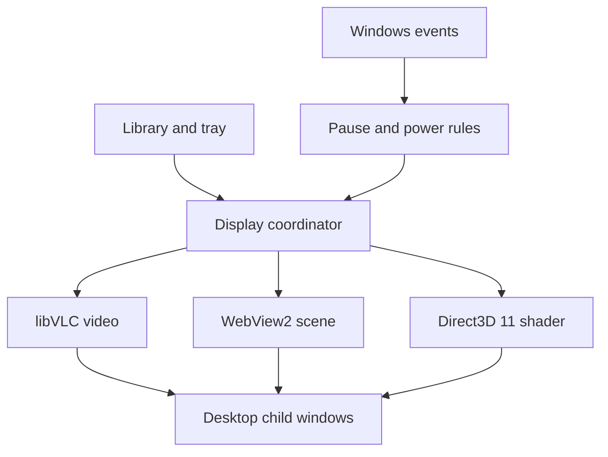

# Aurora Wallpaper

Bring your Windows desktop to life with videos, interactive web wallpapers, and animated shaders. Aurora is a standalone desktop application with a native library window and system tray controls.

## Download and install

**[Download Aurora Wallpaper for Windows](https://github.com/MrBoss1017/Aurora-Wallpaper/releases)**

1. Open the latest release and download **`AuroraWallpaper-Setup-0.1.1-x64.exe`**.
2. Double-click the setup wizard, choose your shortcut options, and install.
3. Launch Aurora, select a wallpaper and a display, then click **Apply wallpaper**.

The installer bundles the application, video playback libraries, and required components. No Visual Studio, Qt installation, or build commands are needed. Requires Windows 11 x64 or Windows 10 22H2 x64. Windows on ARM is not a tested target.

This first release is a **preview**. It is unsigned, so Windows may show an unknown-publisher warning. Download only from this repository's Releases page and compare the provided SHA-256 when needed. Releases are published after automated Windows compile, policy, install, startup, and uninstall checks pass; real desktop/GPU coverage is recorded in [Validation](docs/VALIDATION.md).

## Features

- **Video wallpapers:** local MP4 and WebM files, looping playback, hardware decoding when supported.
- **Interactive wallpapers:** local HTML/CSS/Canvas/WebGL bundles through Microsoft WebView2.
- **Shader wallpapers:** HLSL scenes rendered with Direct3D 11; an animated aurora sample is included.
- **Multiple displays:** different wallpapers per monitor or one scene spanning the desktop.
- **Automatic resource controls:** fullscreen pause, window coverage rules, battery settings, and session-lock pause.
- **Audio controls:** global and per-display mute; audio starts muted.
- **System tray:** pause, next wallpaper, mute, settings, and exit. Closing the library keeps wallpapers running.
- **Local library:** import your own videos, web bundles, or shaders. No account is required.

Desktop mouse mirroring is optional and starts disabled. Imported web bundles should come from sources you trust. Use **Exit** in the tray menu to stop the engine completely.

## How it works

Aurora uses C++20 and Qt Widgets for its native UI, Win32 `Progman`/`WorkerW` parenting to place render surfaces below desktop icons, libVLC for videos, WebView2 for web scenes, and a dedicated Direct3D 11 thread for HLSL shaders.

The desktop technique relies on undocumented Explorer behavior. Unsupported layouts report an error; they are not replaced with an always-on-top window. Hardware decoding and performance depend on the GPU, driver, and media.

## Documentation

- [Architecture and window integration](docs/ARCHITECTURE.md)
- [Create a wallpaper](docs/WALLPAPER_FORMAT.md)
- [Build from source](docs/BUILD.md) — for contributors
- [Installer implementation](docs/INSTALLER.md)
- [Validation and known testing gaps](docs/VALIDATION.md)
- [Third-party notices and source links](THIRD_PARTY.md)

## Contributing and support

Found a problem? [Open an issue](https://github.com/MrBoss1017/Aurora-Wallpaper/issues/new/choose) with your Windows version, GPU, display configuration, wallpaper type, and reproduction steps. See [CONTRIBUTING.md](CONTRIBUTING.md) before submitting code changes.

## License

Aurora's original code and bundled sample wallpapers are released under the **[MIT License](LICENSE)**. Copyright © 2026 MrBoss. Bundled Qt, VLC, Microsoft, and codec components retain their own licenses; see [THIRD_PARTY.md](THIRD_PARTY.md).
