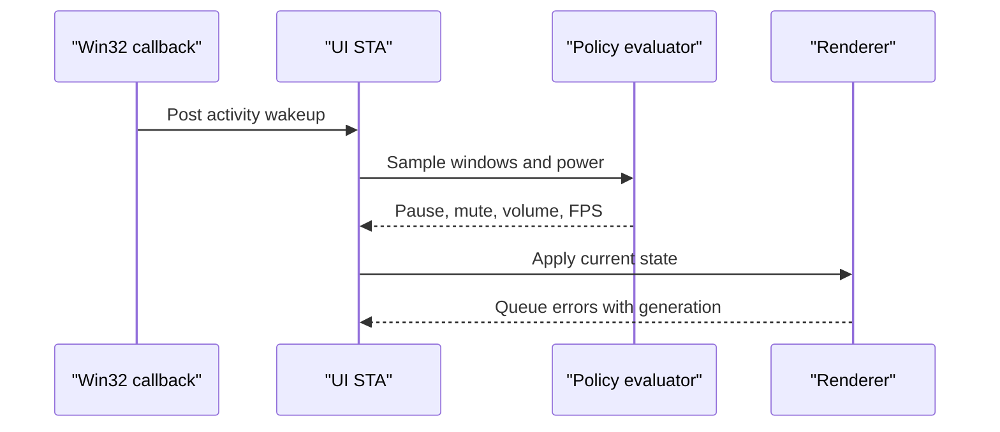

# Architecture and system-call contracts

## Stack decision

| Layer | Choice | Reason |
| --- | --- | --- |
| Core | C++20 / MSVC x64 | Direct Win32 and graphics APIs, RAII ownership, no managed core runtime |
| Controls | Qt 6 Widgets | Native widget controls and tray; Chromium is only instantiated for web wallpapers |
| Video | libVLC 3.x C API | MP4/WebM codecs, hardware decode selection, independent audio controls |
| Web | WebView2 composition controller + DirectComposition | Shared Evergreen runtime; supported native `SendMouseInput` API |
| Shader | Direct3D 11 + HLSL shader model 5 | Modest API complexity, mature HWND presentation and hardware support |
| Persistence | Owned files + atomic JSON via `QSaveFile` | Small local configuration; no service or database required |

Qt offers a convenient future control-UI port. It does not make WorkerW or Direct3D portable. A macOS host would need an appropriate desktop-level NSWindow and a Metal renderer; Linux needs separate X11 and compositor-specific Wayland strategies. There is no universal Wayland equivalent to `SetParent` into a desktop surface. Those backends are not implemented here.

## Desktop host ownership

`DesktopLayer` contains **borrowed** Explorer HWNDs and an Explorer PID. `DesktopHost` owns exactly one application HWND. `Engine::Instance` owns its host and renderer; member declaration order ensures the renderer is destroyed before the host. In normal shutdown, libVLC stops, WebView2 closes, and the D3D worker joins before `DestroyWindow` runs.

| Call | Purpose and handling |
| --- | --- |
| `FindWindowW(L"Progman", nullptr)` | Resolve Explorer's shell host; absence is recoverable |
| `SendMessageTimeoutW(..., 0x052C, ...)` | Request background WorkerW creation; timeout is bounded |
| `EnumWindows` / `FindWindowExW` | Find the icon-host window and the empty sibling behind it |
| `GetWindowThreadProcessId` | Require candidate to belong to the discovered shell process |
| `EnumChildWindows` | Exclude candidates containing `SHELLDLL_DefView` |
| `SetThreadDpiAwarenessContext` | Match the parent before child creation and restore the prior thread context |
| `SetWindowLongPtrW` | Clear `WS_POPUP`, set `WS_CHILD`; check ambiguous zero results |
| `SetParent` | Parent Aurora's HWND to the validated WorkerW; never elevate |
| `PhysicalToLogicalPointForPerMonitorDPI` / `ScreenToClient` | Translate physical monitor coordinates into the parent's coordinate system |
| `SetWindowPos` | Position the child without activation |

The icon layer remains a sibling **above** the wallpaper's WorkerW parent. `HWND_BOTTOM` orders the render child within its parent; it is not what establishes the icon relationship. We do not attach directly to `SHELLDLL_DefView`.

Explorer's `0x052C` message and WorkerW arrangement have no supported API contract. The code implements classic top-level siblings and a validated nested-sibling strategy. It deliberately reports unsupported layouts rather than hiding shell windows or drawing over icons. Compatibility with a particular Windows 11 build is a release-test result, not something that can be inferred from the message number.

`TaskbarCreated`, `WM_DISPLAYCHANGE`, DPI/settings changes, power resume, and a periodic health check trigger reconstruction. Old renderers are disposed before their HWNDs, and asynchronous renderer callbacks carry a generation number so stale callbacks cannot stop replacements. Failed instances retain their assignment and error state; **Apply wallpaper** retries them.

## Threading and state flow

- WinEvent callbacks only post to a hidden top-level event window. They do not enumerate windows or call renderers.
- Event wakeups coalesce over 75 ms. A one-second sampler covers missed events, failed hooks, and geometry changes.
- Pause is immediate once sampled. Resume requires at least 500 ms of continuously clear state; timer sampling can make observed resumption closer to one second.
- Qt and WebView2 remain on the main COM STA. There is no blocking `future.get()` on that thread.
- Shader state is copied under a mutex, then used without that mutex while rendering. A condition variable handles frame deadlines, pause, and shutdown.
- A weak state object guards each WebView2 asynchronous initialization, capture, and suspend callback. On destruction it is marked dead, controllers are closed, and later callbacks become no-ops.
- Video looping uses libVLC's media-list loop mode. Destruction never runs inside VLC event callbacks.

## Policy and monitor semantics

Monitor discovery combines `EnumDisplayMonitors` with `QueryDisplayConfig` and `DisplayConfigGetDeviceInfo`. The GDI display name is used for joining the enumerations; the target device path is persisted when available. Resolution and fullscreen geometry use monitor bounds, not work areas. Refresh rates use the rational numerator/denominator when available. Cloned displays sharing one logical GDI surface are treated as one logical desktop surface.

Visible, non-minimized, non-cloaked application windows are collected. Shell windows, tool windows, Aurora's own controls, and explicitly translucent layered windows are excluded. This is a conservative geometry heuristic: it cannot infer arbitrary per-pixel transparency or exclusive-game state from compositor pixels.

Coverage is the exact area of the union of clipped rectangles. Sweep x boundaries and merge y intervals in each strip; no overlap is counted twice. A fullscreen foreground window must cover the full monitor rectangle within two pixels. A maximized window that leaves the taskbar visible is not fullscreen, but may meet the coverage threshold.

In independent mode, each display gets its own renderer and policy. In span mode, the union bounding rectangle becomes a single surface, including any gaps between monitors. Any constituent fullscreen/coverage trigger pauses the span; the slowest refresh rate caps it; muting any constituent display mutes the span's one audio stream. Independent assignments are preserved while span mode is active.

`Rules` and `Environment` compose manual pause, fullscreen, power, session, display-off, coverage, and mute into one `Playback` value. A resume event cannot override an unrelated active reason. Unknown AC state is not treated as battery. Session lock is distinct from system suspend/resume.

## Rendering paths

**Video:** a shared libVLC instance initializes the decode subsystem, while each display owns a media player and looping media-list player. `libvlc_media_player_set_hwnd` sends native output to the render surface. `--avcodec-hw=any` requests available acceleration and `--vout=direct3d11` selects Windows D3D11 output. There is no CPU frame-copy callback. Unsupported codecs/drivers can still fall back to software decode. MP4/WebM are containers; actual codec support depends on the runtime and hardware. Native aspect ratio is preserved by VLC's output behavior; cropping/stretch modes are not provided.

**Web:** a composition controller renders into a DirectComposition visual rooted at the host HWND. The application uses `SendMouseInput` rather than posting synthetic mouse messages to Chromium's private HWNDs. `CoreWebView2_8::IsMuted` provides exact per-instance muting. HTML media volume is set through the lifecycle script; WebAudio gains are a bundle contract. On pause, capture a PNG poster into an in-memory stream, paint it in the host, hide the browser, then call `TrySuspend`. Resume reconciles the latest desired state even if capture/suspension completed late. If capture fails, the host can show its previous poster or black. If suspension fails, the engine disposes the renderer and reports the fault.

**Shader:** each renderer compiles a built-in fullscreen vertex shader plus the imported `PSMain`. All D3D resources belong to its worker thread. Constants are 32-byte/16-byte aligned. The worker selects the monitor's DXGI adapter, uses a two-buffer flip-discard swapchain, and sleeps to meet its cap. Paused time is excluded from simulation time. `Present` device-removed/reset errors trigger up to three device recreations with a one-second backoff. Creation, compile, or resize failures are surfaced for manual reapply; there is no infinite retry loop and no WARP fallback that could unexpectedly saturate the CPU.

## Mouse input

Raw Input registers only a mouse, using `RIDEV_INPUTSINK`; there is no keyboard registration or global low-level input hook. At receipt and dispatch, both the foreground window and pointer hit window must belong to the Explorer desktop. Coordinates are converted into the individual render host's client space. Move events coalesce to at most about 60 Hz; left-button transitions dispatch immediately. Crossing a monitor or leaving the desktop sends `LEAVE` and releases any mirrored button state.

Mirroring never consumes the actual shell event. Clicking an icon can both animate the wallpaper and activate the icon. There is no icon-specific remote `LVM_HITTEST` call or process-memory access. Right-clicks remain the desktop's context menu; keyboard, touch, and wheel forwarding are not implemented.

## Local content and fault boundaries

Imports are copied into a per-user owned directory. Relative entry paths are validated; web bundle symlinks and junctions are rejected; copy size/file-count limits bound accidental imports. JSON writes are atomic. Renderer objects use RAII. Logs are bounded to two files of approximately 2 MiB each.

Web bundles have per-bundle HTTPS host mappings, no native host objects or native web-message bridge, denied permissions/downloads/new windows, and external ordinary web requests/navigation are blocked. These settings are not a complete network firewall or proof of isolation for hostile content (for example, service-worker/WebSocket behavior needs separate auditing). Use trusted local wallpapers. WebView2 retains its normal Chromium sandbox. HLSL executes on the GPU and libVLC decodes in the application process; arbitrary malicious shaders/media are not isolated by a separate Aurora worker process or job object. No UAC/admin privileges are required.

## Primary references

- [SetParent behavior and DPI caveats](https://learn.microsoft.com/en-us/windows/win32/api/winuser/nf-winuser-setparent)
- [High-DPI desktop development](https://learn.microsoft.com/en-us/windows/win32/hidpi/high-dpi-desktop-application-development-on-windows)
- [SetWinEventHook callback and message-loop contract](https://learn.microsoft.com/en-us/windows/win32/api/winuser/nf-winuser-setwineventhook)
- [RegisterRawInputDevices](https://learn.microsoft.com/en-us/windows/win32/api/winuser/nf-winuser-registerrawinputdevices)
- [WebView2 composition controller](https://learn.microsoft.com/en-us/microsoft-edge/webview2/reference/win32/icorewebview2compositioncontroller)
- [WebView2 lifecycle, virtual host mapping, and TrySuspend](https://learn.microsoft.com/en-us/microsoft-edge/webview2/reference/win32/icorewebview2_3)
- [WebView2 bounds and rasterization scale](https://learn.microsoft.com/en-us/microsoft-edge/webview2/reference/win32/icorewebview2controller3)
- [libVLC 3.x media-player API](https://videolan.videolan.me/vlc-3.0/group__libvlc__media__player.html)
- [DirectComposition device creation](https://learn.microsoft.com/en-us/windows/win32/api/dcomp/nf-dcomp-dcompositioncreatedevice)

The implementation is original project code; these references document the public API contracts. The WorkerW message itself remains undocumented.
